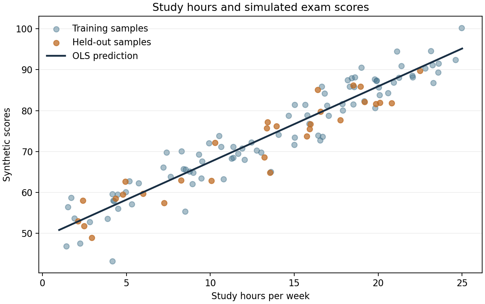

# Python Pickling Tutorial

**Yao Qiqi** · Data Engineering, Session 3

This exercise saves Python objects and a trained regression model to disk, then reloads them in a fresh Python process. Pickling turns an object into bytes. Unpickling restores the object so its data and methods can be used again.

| Exercise | Published files in `artifacts/` |
| --- | --- |
| Save a list and dictionaries | `fruits.pkl`, `scores.pkl`, `complex_data.pkl` |
| Restore, update, and save a custom grade tracker | `course_grades.pkl`, `course_grades_updated.pkl` |
| Fit and save a scikit-learn linear regression | `study_hours_model.pkl`, `metrics.json`, `study_hours_model.png` |
| Save the same model with joblib and compare predictions | `study_hours_model.joblib` |

The regression uses 120 synthetic study-hour and score pairs, with 90 for training and 30 for evaluation. The example records mean squared error and R² on the held-out samples. The loader compares the two restored models' predictions against the predictions recorded before saving, using the same four inputs. The score data are fictional.

## Run with Python 3.11

```sh
python -m pip install -r requirements.txt
python save_examples.py
python load_examples.py
```

Use `python load_examples.py` by itself to load the already published files without training. Keep `grade_tracker.py` importable because the pickle stores a reference to its `GradeTracker` class. Use the pinned scikit-learn version to reload the model.

Only load pickle and joblib files you trust. Deserializing those formats can execute code. This example loads files created by its own save script.



Course source: [Session 3 exercise](https://gitee.com/lundechen/data_engineering_master_2026_fall/blob/master/session-3/practice-pickling-of-a-model.md).
